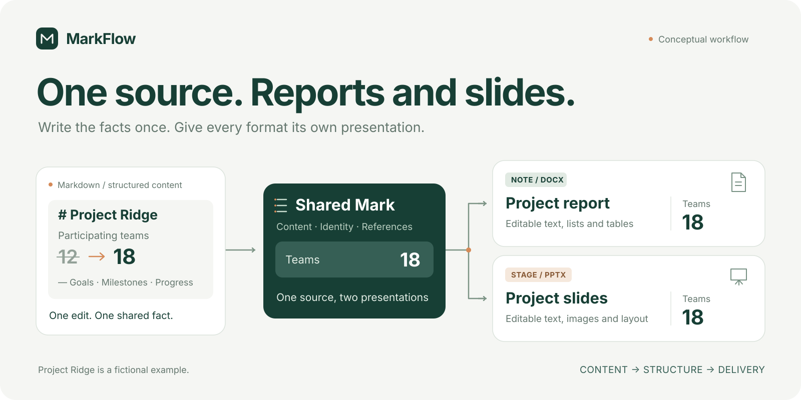
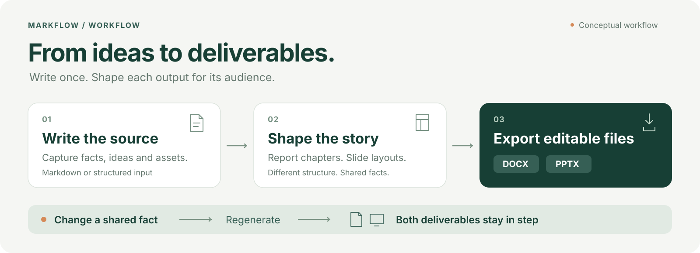
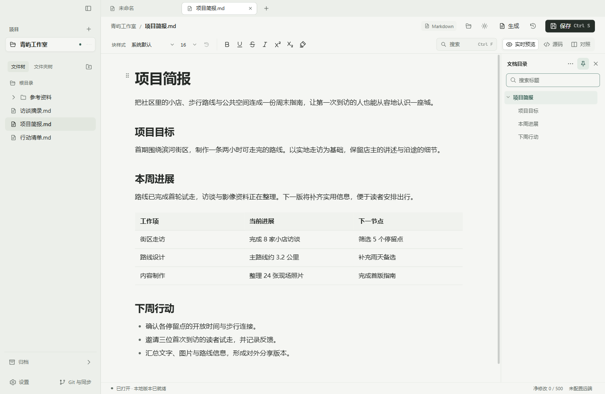
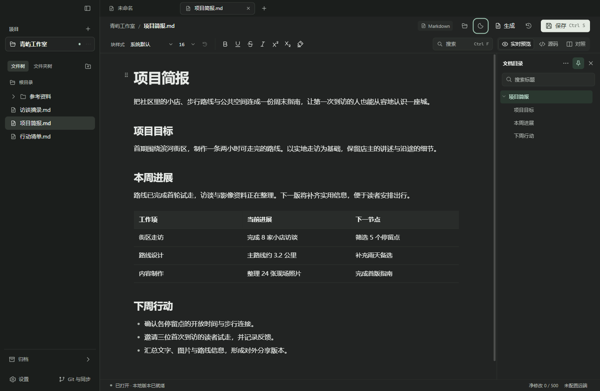
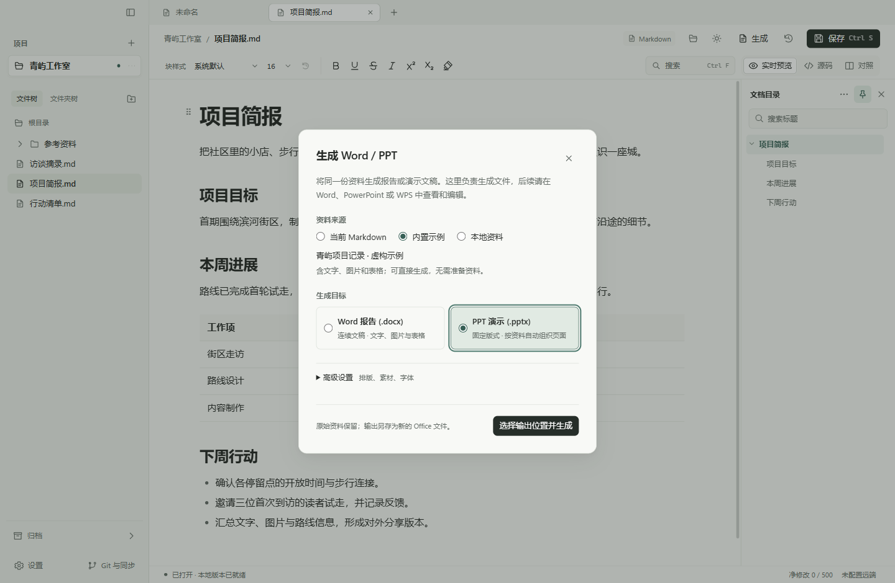

# MarkFlow

[中文](README.md) · **English**



**Turn one set of source material into reports and presentations.**

MarkFlow is a local-first writing workspace and document compiler. Write in Markdown, organize reusable content as Marks, and generate editable Word reports and PowerPoint presentations. When the material changes, update the shared content and regenerate both deliverables.

[Get started](#get-started) · [Explore the example](#one-change-two-deliverables) · [Product design](docs/PRD.en.md) · [Development guide](docs/DEVELOPMENT.md) · [Roadmap](OopsMD-TODO.md)

## Shared content. Purposeful output.

- **Keep the facts together.** A report develops the detail; a presentation highlights the key points. Separate content from presentation so both use the same source material.
- **Carry changes through.** Change “12 cities” to “18 cities” in the shared source, regenerate, and see the corresponding content update in both files.
- **Hand over files people can edit.** DOCX and PPTX output contains native text, tables, and image objects, ready for further work in familiar office software.
- **Work locally, integrate freely.** Editing, saving, and compilation need no account or AI API key. Use the desktop workspace or call the SDK / CLI from your own tools.



## One change, two deliverables

The repository includes a complete example: one set of project material and two presentation descriptions produce a **2-page report and a 4-slide deck**. Change a shared fact and regenerate to see both outputs update.

| Deliverable | Original source: 12 cities | Updated source: 18 cities |
| --- | --- | --- |
| Word report | [Open the report](examples/compiler/generated/report.docx) | [Open the updated report](examples/compiler/generated/updated-report.docx) |
| PowerPoint deck | [Open the deck](examples/compiler/generated/deck.pptx) | [Open the updated deck](examples/compiler/generated/updated-deck.pptx) |

The files use the same fictional project material, written in Chinese. Text, table, and image edits have been saved and reopened in WPS on Windows. [Source files and commands](examples/compiler/README.md) · [Acceptance record](docs/compiler/ACCEPTANCE.md)

## A workspace for everyday writing

Start writing, then choose where to save. Your files stay in your own folders. Each tab keeps its draft, editing state, and undo history.



Markdown offers formatted editing, source, and split views. Adjust the typeface, size, and order of individual Marks, and navigate longer documents with the outline. Fomula supports both instant math snippets and complete LaTeX documents with actual PDF output.

Use **＋ → Fomula**, then choose **公式片段 / LaTeX 文档** (math snippet / LaTeX document). Create a Chinese or English document, edit multiple source files, and configure paper size, body text, headers and footers through a form. The compiled PDF scrolls independently. Slash suggestions, Tab completion, references, and PDF/source-package export are available. [Setup, usage, and current limits](docs/LATEX-WORKSPACE.md)

Select the current Markdown snapshot or a local Mark document to generate a paper with title, authors, abstract and references. Generated sources retain provenance; save a separate LaTeX project for direct editing. The full Windows distribution includes an optional offline runtime installer. Actual macOS acceptance remains pending. [Evidence and limits](docs/PAPER-DELIVERY.md)

Enable Git when you want version history. Saving, local commits, and remote synchronization are separate actions. Automatic version recording defaults to **500 net changed characters**, with an adjustable threshold and an off switch.

<details>
<summary>See the dark workspace</summary>



</details>

## Generate Word and PowerPoint files in the workspace

Click **Generate** (`生成`) beside the file path. Choose the current Markdown document, the built-in example, or a local source file, then select a Word report or PowerPoint deck.



Screenshots show the current Chinese desktop interface. English documentation is available here; application language switching is on the roadmap.

Generate from the current document's unsaved editing snapshot. Open the completed file to continue working. If a resource is missing or content exceeds a slide's capacity, diagnostics explain the issue and offer content navigation where available.

The current generator supports headings, paragraphs, flat lists, simple tables, PNG/JPEG images, and common text formatting, with a fixed report theme and four slide layouts. [Input reference](docs/compiler/LANGUAGE.md)

## Get started

### Run the desktop workspace

Install **Node.js 22.12+** and Git. The repository's Node.js version is recorded in [`.nvmrc`](.nvmrc).

```bash
git clone https://github.com/goldenccar/MarkFlow.git
cd MarkFlow
npm ci
npm exec --no -- install-electron
npm run dev
```

Start writing, or open **Generate → Built-in example** (`生成 → 内置示例`) to try the complete output workflow.

### Run just the compiler

From the project directory, install dependencies and run the example without launching the desktop app:

```powershell
npm ci --ignore-scripts
npm run compiler:demo -- --font C:/Windows/Fonts/msyh.ttc
```

Output is written to `examples/compiler/generated`. This command uses the Microsoft YaHei font installed on Windows; fonts are supplied by the local environment. [SDK / CLI and font configuration](docs/compiler/SDK.md)

MarkFlow is a development release. Desktop generation and output editing have been checked on Windows with WPS; macOS has separate desktop development checks. See the [development guide](docs/DEVELOPMENT.md) and [validation history](docs/VALIDATION.md) for Windows packaging, cross-platform work, and version-specific coverage. These detailed guides are currently in Chinese.

## Where MarkFlow is going

The long-term direction is a shared content model that people and AI can work on together.

| Stage | Capabilities |
| --- | --- |
| Available now | Local Markdown / Fomula workspace, shared-source DOCX / PPTX generation, desktop generation, standalone SDK / CLI |
| Next | Custom AI API connections, focused edits, change previews and undo, and full-cost comparisons |
| Further ahead | Source-linked knowledge assistance, visual Note / Stage editors, Array spreadsheets, and tools for existing PDFs |

AI will use explicit content operations through the existing editing and saving workflow. See the [product design](docs/PRD.en.md) and [development checklist](OopsMD-TODO.md) for the plan and progress.

## Help make the next deliverable better

Contribute reusable examples, layouts, format adapters, or fixes. A small input you can share publicly, its expected output, and the actual result make an excellent issue report.

[Report an issue](https://github.com/goldenccar/MarkFlow/issues) · [Development and tests](docs/DEVELOPMENT.md) · [Compiler structure](docs/compiler/WRITERS.md) · [Product requirements](docs/PRD.en.md)

## License

MarkFlow is available under the [MIT License](LICENSE).
