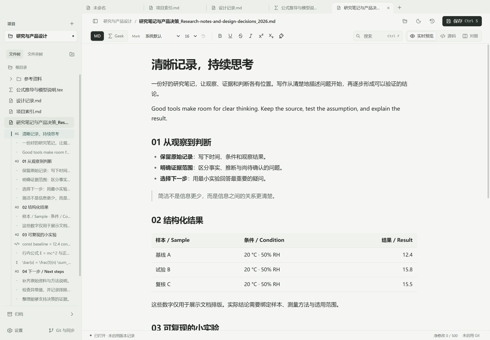
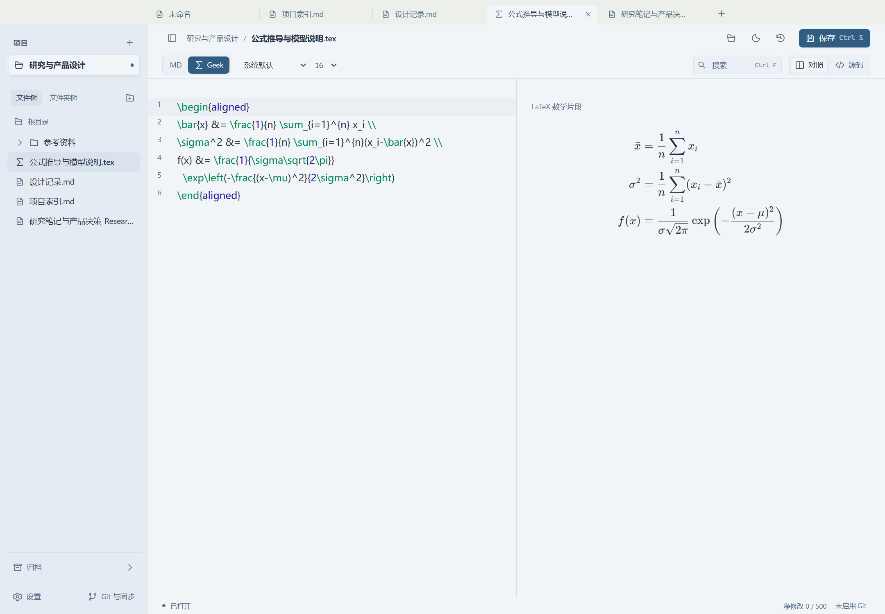
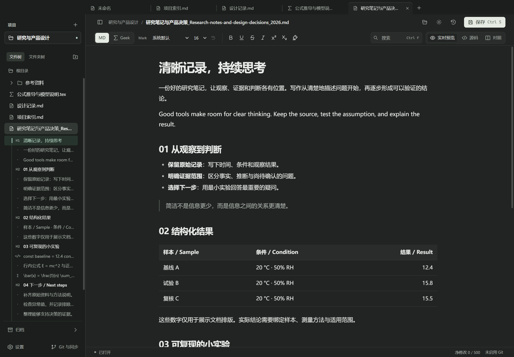

# OopsMD

以本地 Markdown 文件为基础的 Windows 写作工具，支持 Mark 独立排版、LaTeX 数学片段与 Git 版本记录。

[开始使用](#从源码启动) · [使用指南](docs/USAGE.md) · [开发与调试](docs/DEVELOPMENT.md) · [开发清单](OopsMD-TODO.md)



## 可以做什么

| 功能 | 说明 |
| --- | --- |
| 三种编辑视图 | 直接编辑排版后的 Markdown，随时切换源码或对照；保留正文和撤销历史 |
| Mark 独立排版 | 为标题、段落、列表项分别设置字体与字号，从大纲定位、移动和复制 |
| 本地项目与草稿 | 文件夹即项目；先写后选保存位置，支持恢复草稿、文件移动和逻辑归档 |
| 浏览器式标签 | 多文档切换、固定、拖动排序和重新打开；每个标签保留独立编辑状态 |
| Geek 数学模式 | 输入 LaTeX 数学片段，以源码与公式对照查看 |
| Git 版本记录 | 明确启用后按净修改阈值记录本地版本，支持历史查看及手动 GitHub 同步 |

无需账号即可编辑与保存。文档保存在自己的文件夹中，默认 **500** 的自动版本阈值可调整；文件保存、本地提交和远端同步分别报告结果。

<details>
<summary>查看 Geek 对照与夜间模式</summary>

**Geek：编辑数学片段并查看公式。**



**夜间：中性深色界面。**



</details>

## 从源码启动

准备 **Windows、Node.js 22.12+ 和 Git for Windows**。建议使用 [`.nvmrc`](.nvmrc) 中的 Node.js 24.15.0。

```powershell
git clone https://github.com/goldenccar/MarkFlow.git
cd MarkFlow
npm ci
npm exec --no -- install-electron
npm run dev
```

命令会打开 Electron 窗口。直接输入，按 **Ctrl+S** 选择文件夹与文件名；也可以从左侧项目加号打开已有文件夹。Electron 首次使用需要下载运行时。

已安装依赖时只需 `npm run dev`。前端修改热更新，主进程和 preload 修改会重启窗口。**F12** 打开界面调试工具；主进程断点、独立测试配置与打包步骤见 [开发指南](docs/DEVELOPMENT.md)。

## 一份文件，多个 Mark

Mark 是文档中的内容单元，例如标题、段落或列表项。可以单独调整排版、在大纲中移动或复制；它们仍属于同一份 Markdown 文件。

Mark 的身份和局部样式随文件尾部的 Oops 注释保存。首次只读打开普通 Markdown 不会改写磁盘，主动保存时才将身份元数据一并写入。其他 Markdown 工具通常仍显示正文，但不解释 Oops 的局部样式。详见 [Mark 与局部排版](docs/USAGE.md#mark-与局部排版)。

底层 Mark 引擎可独立构建，提供稳定 ID、原子事务与撤销，并以可选引用协议和版本化快照恢复为后续复用准备；当前页面引擎仍是草案。接口与适配边界见 [引擎架构](docs/OOPS-ENGINE-ARCHITECTURE.md)。

## 当前范围

- 当前文档介绍源码开发版。已验收平台为 **Windows**；macOS 开发接续尚未实机验收，macOS / Linux 安装包也未验证。
- Geek 处理数学片段，尚无完整 TeX 编译、PDF 导出、Word / Excel / PPT / PDF 编辑、跨文件全文搜索或 AI。
- `release` 中原有的 0.1.0 安装包对应较早版本，尚未包含当前全部更新。请用源码体验本页功能；测试范围与人工待验收项见 [验证记录](docs/VALIDATION.md)。

## 文档

| 文档 | 内容 |
| --- | --- |
| [使用指南](docs/USAGE.md) | 项目、草稿、快捷键、Mark、归档、Git 配置与冲突处理 |
| [开发与调试](docs/DEVELOPMENT.md) | 环境准备、断点、独立 profile、测试、打包与换机开发 |
| [Mark 引擎架构](docs/OOPS-ENGINE-ARCHITECTURE.md) | 独立引擎、Markdown 适配、身份与未来页面边界 |
| [设计规范](docs/DESIGN-SYSTEM.md) | 主题、排版、控件与响应式布局 |
| [验证记录](docs/VALIDATION.md) | 已执行的测试、性能条件和未验收范围 |
| [Git 运行时](docs/GIT-RUNTIME.md) | Windows 随包 Git 的来源、校验及第三方许可证 |
| [开发清单](OopsMD-TODO.md) | 首版范围与后续计划 |

## 许可证

本项目使用 [MIT License](LICENSE)。随包 Git 及其他依赖保留各自的许可证，详见 [Git 运行时说明](docs/GIT-RUNTIME.md)。
