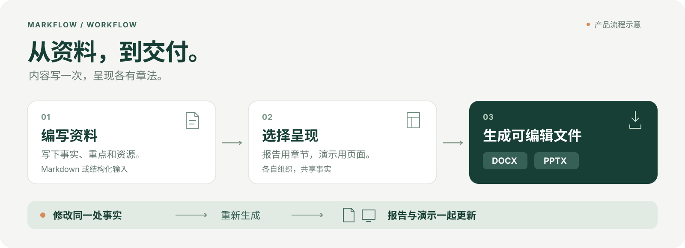

# MarkFlow · 产品设计

**一份内容，多种交付。**

**中文** · [English](PRD.en.md) · [项目首页](../README.md) · [开发清单](../OopsMD-TODO.md)

图示展示当前已实现的生成子流程，不代表全部产品场景。

MarkFlow 是以 Mark 为内容核心的本地办公工作区，同时提供可独立调用的文档语言与编译器。用户在这里创建、打开、编辑和维护不同类型的内容，配置呈现方式，再交付所需格式。共享内容可以用于文档、演示及后续表格/PDF；生成 Word/PPT 是其中一条交付路径。

这份 PRD 描述产品要解决的问题、核心体验与演进方向。当前已具备本地写作工作区、DOCX / PPTX 编译器、桌面生成入口及 SDK / CLI。实现进度见开发清单，运行证据见[验证记录](VALIDATION.md)。

更新日期：2026-10-31 · 产品阶段：开发版

本轮优化约束：保留 Note 的共同内容/模板/分页设计、已有 DOCX 输出，以及 Stage 的原生 PPTX 输出与演示模型；论文模块继续共用 Mark 基础。以自有生产源码减半、关键工作流提速 50% 以上为目标，分别记录源码字节/非空行和同机前后耗时。依赖、生成文件、样例和测试不计入生产源码；不通过删功能、删校验、移走代码或压缩行数达标。局部处理、完整生成与桌面输入分别报告，未达到的目标保留待办。

本次范围校正：恢复原 PRD 的多类型编辑与持续工作场景，增加 Note 模板配置及跨页实时预览要求。保留已经实现的编译能力与验收记录，不把 DOCX/PPTX 生成视为 Note/Stage 编辑器完成。下文新增交互属于待实现需求。

本次论文路线已接入开发版：独立 LaTeX 项目、三类模板、多文件源码编辑、快照编译、内置 PDF 预览及 PDF/源包导出。Formula 保留轻量公式体验。2026-10-31 已补 Windows 冻结离线环境、应用内安装/取消/回退及受限 Mark → LaTeX。实际 macOS、干净操作系统与整机断网、操作系统级隔离仍未验收；范围与证据见[本轮交付记录](PAPER-DELIVERY.md)。

## 1. 在本地持续创作、编辑和维护内容

用户在自己的文件夹里组织资料，先写草稿、再选择保存位置，并持续打开已有文件修改。文字、公式、文档、表格、演示和已有 PDF 保留各自适合的编辑方式，共用项目、标签、资源和版本管理。

同一组事实还可能用于报告和演示。MarkFlow 用明确的内容引用减少重复维护：**共同内容维护一份，不同交付物各有表达。**

| 使用者 | 要完成的工作 | MarkFlow 提供的价值 |
| --- | --- | --- |
| 使用多种办公内容的人 | 创建、阅读、修改和交付材料 | 在同一工作区使用适合内容类型的编辑器 |
| 持续更新项目资料的小团队 | 让报告与演示使用同一组事实 | 共享内容与呈现分离，更新来源后重新生成 |
| 开发文档工具的开发者 | 为自己的应用加入报告或演示输出 | 通过 SDK / CLI 调用同一个编译器 |

产品同时保障日常创作与反复交付：打开或创建内容、持续编辑、配置呈现、预览和保存，再交付所需格式。长期价值来自内容持续复用、完整的工作区体验和可靠输出。

### 必须保留的使用场景

以下是产品场景，不是将所有内容转换为 Markdown 后导出的别名。模块可以按阶段交付，编译器里程碑不能替代相应编辑流程。

| 场景 | 用户完成的流程 | 当前边界 |
| --- | --- | --- |
| Markdown 写作与项目资料 | 新建/打开 → 排版或源码编辑 → 导航 → 保存与恢复 | 已实现；继续独立维护 |
| Fomula 数学片段 | 新建公式 → 输入源码 → 对照渲染 → 修改与保存 | 已实现；不等于完整 TeX |
| 完整论文写作 | 打开 LaTeX 项目或选择模板 → 编辑正文与引用 → 查看 PDF → 保存与交付 | 开发版已接入源码/PDF 工作流；L0–L4 按实际缺口继续验收 |
| Note 文档创作 | 新建文档 → 编辑正文 → 配置模板 → 跨页预览 → 保存、导出及重开 | 文档编辑器及分页预览尚未实现；已有 DOCX 输出 |
| Array 工作簿 | 创建/打开 → 编辑单元格和公式 → 重算 → 图表 → 保存重开 | 尚未实现；不含筛选器、切片器 |
| Stage 演示创作 | 创建/打开 → 管理幻灯片 → 编辑页面元素 → 展示 → 保存重开 | 页面编辑器尚未实现；已有 PPTX 输出 |
| 已有 PDF 处理 | 打开 → 阅读/页面管理 → 在支持范围内修改 → 保存或另存 | 通用 PDF 工作区尚未实现；论文成品另有 PDF.js 预览；禁止无来源空白创建 |
| 多文件持续工作 | 项目和归档管理 → 多标签切换 → 保留草稿、撤销、布局和版本 | 现有文本模块已接入；新模块须完整接入 |
| 跨格式复用与工具调用 | 共享事实或图片 → 各自组织内容与模板 → 生成多种交付物 | DOCX/PPTX 编译已接通；其他适配逐项实现 |

本地知识检索与受控 AI 操作是第 7 节的独立后续场景。正文编辑、模板配置和交付不依赖 AI 或模型密钥。

## 2. 编辑、配置、预览与交付

图示为共享内容到交付的路径；编辑工作区与模板/分页体验按下文分别建设。

### 写下内容

从一份 Markdown 开始，或使用结构化 MarkFlow JSON 管理需要复用的内容。标题、段落、列表、表格和图片组成一份明确的资料。

**Mark 是可识别、可引用、可修改的内容单元。** 它给后续调整提供稳定的目标，让内容移动、复制和更新都有可追踪的关系。

### 选择表达

报告可以展开背景、过程和结论；演示可以选择重点、调整顺序并使用图文版式。两者引用共同资料，分别维护自己的呈现描述。

默认呈现让用户先得到结果；需要精确组织时，再指定章节、页面、版式和资源。

### 模板配置页与 Note 工作区（待实现）

模板配置是独立、可持续打开的页面/标签，不是阻塞编辑的导出弹窗。用户可以先建好模板再写作，也可以在文档与模板配置页之间切换，并行调整。默认通过表单配置，JSON 作为保存格式及高级源码入口，不要求手写。

Note 默认采用左侧内容编辑、右侧跨页预览：

- 左侧维护正文和结构，可按能力切换源码；右侧展示带实际断页、页边距、页眉页脚和页码的连续页面栈。
- 两侧有独立滚动位置。右侧可以停在任意页，左侧输入、移动光标或滚动不能把右侧强行带走；联动定位仅在用户明确操作时发生。
- 模板页可配置纸张、边距、标题/正文/表格样式，页眉页脚左中右区域，Logo、文档字段、动态页码及首页/奇偶页差异。默认提供可直接使用的模板。
- 模板草稿立即用于当前文档预览；“应用到当前文档”和“保存为可复用模板”分开。模板版本更新不静默改动其他文档。
- 预览异步更新，保留光标、撤销和阅读位置；旧任务不能覆盖新结果。模板错误或排版失败保留编辑内容和上一份有效预览，并标明其版本落后。
- 页式预览不改变 Markdown 的现有流式阅读。Note、Stage、Array、PDF 采用各自的显示和领域模型。

“自适应”按规则处理换行、分页、图片缩放、跨页表格和重复区域，不能通过裁掉内容或无限缩字伪装成功。浏览器分页预览与 Word/WPS 原生分页须明确区分；实时预览不能未经验证就承诺与任何 Office 软件页数或像素完全一致。需要交付校对时，使用声明版本的目标排版引擎生成原生结果预览。

具体排版算法、资源与性能边界、实施顺序和验收见 [Note 模板与分页设计](NOTE-PAGINATION.md)。

### 生成并交付

选择 Word 报告或 PPT 演示，生成 DOCX / PPTX。文字、表格和图片保留为原生对象，接收方可以继续编辑。

资料更新后，修改共享内容并重新生成。源内容负责长期维护，输出文件负责交付；从 Office 文件回收外部修改，会随对应导入能力逐步接入。

### 一个可以亲手验证的例子

现有示例用同一份虚构项目资料生成 **2 页报告与 4 页演示**。把“12 个城市”改为“18 个城市”，两类输出中的对应事实随之更新；故意放入过长内容，则返回指向具体 Mark 的页面容量诊断。

[查看源资料](../examples/compiler/content.json) · [报告](../examples/compiler/generated/report.docx) · [演示](../examples/compiler/generated/deck.pptx) · [完整示例](../examples/compiler/README.md)

## 3. 一套内容基础，多个创作入口

产品正式名称为 **MarkFlow**。模块共享内容基础和工作区，各自处理适合自己的编辑方式。

| 模块 | 体验与职责 | 当前进展 |
| --- | --- | --- |
| Markdown | 排版写作、源码编辑、对照阅读、内容导航 | 已有桌面编辑器，可作为生成来源 |
| Fomula | LaTeX 数学片段与实时公式渲染 | 已有独立编辑器 |
| Fomula 完整文档 | 完整 LaTeX 工程、论文模板、引用、PDF 预览与源码交付 | 开发版已接入；本机 Windows 编译有结果，完整分发与跨平台待验收 |
| Note | 连续正文、章节、模板配置与跨页预览 | 尚无 Note 编辑器/分页预览；当前仅接通 DOCX 生成 |
| Stage | 页面叙事、固定版式、元素编辑和展示 | 尚无 Stage 页面编辑器；当前仅接通 PPTX 生成 |
| Array | 工作簿、单元格、计算和图表 | 后续独立路线 |
| PDF | 阅读已有文件，管理页面并修改支持的内容 | 后续独立路线 |

**同一个工作区，不要求所有内容使用同一种编辑器。** Note 组织连续正文，Stage 组织固定页面，Array 管理工作簿。共享核心提供身份、引用、事务和资源，各模块保留自己的领域模型。

各模块须提供完整的创建/打开、编辑、保存和重开闭环，并分别声明格式支持范围。Note 包含连续正文、分页、图片、表格、字体和页眉页脚；Stage 包含幻灯片增删排序、页面元素与展示，以静态页面及可计算的简单位移为先，不做复杂动画。Array 将工作簿/单元格模型、公式依赖与计算、图表绑定/渲染分开。已有 DOCX/PPTX 写出能力不代表已支持任意 Office 文件导入或保真往返。

模块命名与语言约定

| 内容类型 | 英文创建入口 / 类型名称 | 中文创建入口 | 中文类型名称 |
| --- | --- | --- | --- |
| 文档 | Note | 创建文档 | 文档 |
| 表格 | Array | 创建表格 | 表格 |
| 演示 | Stage | 创建演示 | 演示 |
| 数学片段 | Formula | 创建公式 | 公式 |
| Markdown | Markdown | 创建 Markdown | Markdown |

英文创建入口直接使用模块名；中文入口使用功能名称。工具提示、操作反馈和无障碍名称跟随界面语言。语言切换保持正文、文件名、扩展名、文档类型和撤销历史不变。

当前桌面主要使用中文，完整界面语言切换属于后续工作。Markdown 保留独立入口，首次启动和通用新建默认创建 Markdown；与 Note 的入口关系在编辑器接入时确定。创建入口随实际可用的编辑能力开放，Office 生成入口独立提供。

PDF 使用“打开 PDF / Open PDF”，独立产品名待定。PDF 工作流始于已有文件，界面与内部命令均不创建无来源空白 PDF；打开取消或失败时不留下空白草稿。已有 PDF 可以编辑、原位保存或另存副本，其他模块从有效内容导出 PDF 另行接入。

OopsMD、Geek 为历史名称。已有数据目录、安装升级标识、`latex-math` 类型以及草稿和标签键保持兼容。

### Fomula 统一入口（2026-10-31）

数学片段与完整 LaTeX 统一在 **Fomula** 入口内，通过“公式片段 / LaTeX 文档”切换。完整文档沿用源码与预览对照的视觉结构，右侧真实 PDF 独立滚动。可视化页面配置写入主文件受控区并支持撤销；外来模板的自定义规则不自动覆盖。单独输入 `/` 或反斜线触发提示，字母匹配优先、使用频次和最近使用作为次序依据；Tab 在补全之外负责缩进。内部数据模型与编译器保持独立，既有笔记、Note 和 Stage 路线不变。下文历史名称 Formula 对应当前 Fomula。

**共用工作区框架：** Markdown、公式片段和 LaTeX 文档使用唯一的 `ApplicationBar` 与 `ProjectSidebar`。应用栏固定按打开文件、主题、版本历史、保存排列；引擎差异命令放在第二栏，允许随窗口宽度换行。项目侧栏使用同一份系统项目登记、归档、Git 和文件树状态，统一拖动及右键操作。`PaperWorkspace` 仅负责引擎正文、编译、PDF 与页面设置，不保留私有应用栏或项目侧栏。通用设置在侧栏底部，编译环境在第二栏；源码显示沿用通用字体与字号。页面设置只覆盖源码区域，开合不重建 PDF 或改变其滚动位置；窄窗改为源码/PDF 切换，减少动态效果时取消过渡。

**补全配置：** 设置中分别管理 Markdown、公式片段和完整 LaTeX 的触发符、匹配规则、排序、内置标记开关及自定义文本片段。规则和频次按引擎隔离；修改立即生效，不重建编辑器或重置正文与撤销记录。配置持久保存，本机频次不记录正文；不引入 AI 或可执行配置脚本。

### 论文工作区：当前交付与后续要求

| 能力 | 本轮实现与验证边界 |
| --- | --- |
| 项目与模板 | Fomula 新建、打开、ZIP 导入、Mark 生成和独立副本加入系统项目列表；共用文件树/归档/Git，子文件保留已授权项目根；中文、英文单栏/双栏模板生成普通 TeX 项目，主文件与引擎在第二栏选择 |
| 编辑与编译 | 多文件源码、设备草稿、保存冲突保护；系统树移动迁移历史草稿，重新定位保留旧恢复备份，来源生成稿在通用文件操作中仍只读；所有已打开文件的未保存缓冲进入统一快照；后台 latexmk、取消/超时、过期结果保护，失败保留上次 PDF |
| 成品与定位 | PDF.js 连续页面、独立滚动、缩放/页码、按需绘制；编译日志定位和显式 SyncTeX 双向定位。它是编译成品预览，不是已有 PDF 对象编辑器 |
| 常见操作与交付 | 章节/公式/表格片段、图片选择、项目文献 key 搜索和引用插入；导出 PDF 与带输入摘要、主文件/引擎/环境记录的源 ZIP。尚不等同于可视化表格编辑或完整文献管理 |
| 当前运行环境 | Windows 完整冻结 TeX 环境约 341 MiB，364 包；应用内安装、进度、取消/重试、回退与同版本离线导入。实际 macOS、干净系统/整机断网及任意宏包自动修复待验收；没有虚构在线下载地址 |
| 证据与限制 | 中文、英文单栏/双栏及各自源包回编、嵌套主文件 Biber 样例有原生编译结果；不据此宣称本轮桌面全量验收、安装包或性能优势。当前无操作系统级隔离，仅允许用户信任后编译外来项目；受限 Mark → LaTeX 已接入，完整支持边界按 L4 跟踪 |

当前使用与支持范围见[论文工作区说明](LATEX-WORKSPACE.md)，逐项验收状态见[开发清单](../OopsMD-TODO.md#paper-workspace-todo)。以下保留完整产品要求；超出本表的能力仍需实现和验收。

**让用户把精力放在论文本身。** 打开已有项目，或选一个模板开始写作；MF 管理主文件、编译环境、字体和参考文献流程，在本地生成可以检查和交付的论文。基础流程无需模型服务或 API 密钥。

Overleaf 已提供免本地安装、源码与可视化编辑。MF 的目标是进一步简化本地资料整理、常见论文操作和问题恢复，并让研究内容能够复用于报告和演示。“更简单、更快”通过任务对照验证。[Overleaf 编辑方式](https://docs.overleaf.com/getting-started/how-do-i-use-overleaf)

#### 两个入口，同一个论文工作区

| 入口 | 用户体验 | 内容来源 |
| --- | --- | --- |
| 打开已有论文 | 打开文件夹或 ZIP，识别主文件与依赖，准备环境后查看 PDF；存在多个主文件时选择一次并记住 | 原始 `.tex` 工程及其 `.bib/.cls/.sty/.bst`、图片等资源 |
| 从模板开始 | 选择已验证模板，填写标题、作者、摘要，进入正文写作 | 首阶段创建普通 LaTeX 项目；L4 再提供 Mark 结构化写作 |

首批模板覆盖英文单栏、双栏和中文文章，验证多文件章节、公式、图表、交叉引用及参考文献。模板记录版本、所需引擎、宏包和字体，常规使用不要求编辑导言区或设置系统路径。

左侧提供章节和资料，中间编辑正文，右侧显示编译得到的最终 PDF。支持源码编辑，并逐步为插图、图注、公式、引用和参考文献提供直接操作；任意外来 LaTeX 仍保留源码入口。PDF 与正文默认独立滚动，点击定位才联动，重新编译保留正在阅读的位置。完整论文的预览来自 TeX 成品，区别于 Formula 的 KaTeX 公式预览，也区别于 Note 的浏览器分页。

| 写作动作 | 需要提供的能力 |
| --- | --- |
| 添加图表 | 选择或拖入图片、填写图注；在支持的表格结构中编辑内容，由模板管理编号和排版 |
| 插入参考文献 | 导入或搜索项目 `.bib` 条目，选择后插入引用，由 BibTeX/Biber 生成文献表 |
| 引用公式、图表或章节 | 从可识别目标中选择，维护标签与交叉引用，发现缺失或重复标签 |
| 调整论文格式 | 新建时选择模板；后续模板切换预览差异并保留原内容，对自定义宏和不兼容设置给出定位提示 |
| 处理错误 | 给出对应文件、行与可执行的修复建议，保留原始日志；点击跳转，保留上一份有效 PDF |
| 交付论文 | 导出 PDF 和包含必要相对路径资源的源文件包，并记录编译环境与来源版本 |

#### 由应用管理编译环境

目标环境采用 **固定版本 TeX Live＋latexmk**：复用成熟的 pdfLaTeX/XeLaTeX/LuaLaTeX 与文献处理链，按模板要求选择引擎。当前开发环境以 TinyTeX 为精简底座，不引入 R；完整冻结、自动补齐资源及应用内环境准备仍按 L0 建设。PDF.js 已接入内置 PDF 预览，SyncTeX 已接入源码与成品定位。[TeX Live](https://tug.org/texlive/doc/texlive-en/texlive-en.html) · [latexmk](https://ctan.org/pkg/latexmk) · [PDF.js](https://mozilla.github.io/pdf.js/)

后续托管环境须满足以下要求，不能用本机准备脚本代替分发验收：

- 主程序与论文环境分开分发，首次使用自动准备并显示进度；支持取消、失败重试和完整离线资源包。模板依赖准备齐全后，可以断网编辑、编译和导出。
- 运行时、宏包快照、模板、中文字体及 BibLaTeX/Biber 组合共同固定版本；按平台提供对应执行文件，项目记录可复现配置，不依赖另一台电脑碰巧安装的字体。
- 从可信来源下载并校验依赖，新增依赖留在同一环境版本；升级显式进行，失败保留已有可用环境。用户需要特殊设置时可进入高级配置。
- 导入项目保留原目录关系；`.tex` 根据项目角色处理，旧 Formula 文件、草稿和标签类型保持兼容。主文件、章节子文件和公式片段不能仅按扩展名混为一类。

Tectonic 留作受控模板的轻量备选；Typst 留作未来 Mark 排版后端。首轮集中验证一套 TeX 链路，已有期刊模板直接交给相应 TeX 引擎，避免同时维护多套编译体系。[Typst 与 LaTeX 的关系](https://typst.app/docs/guides/for-latex-users/)

#### 复用工作区，补齐四个职责

| 新增职责 | 负责的事情 |
| --- | --- |
| 论文项目 | 主文件与引擎选择、模板及资源关系，接入已有标签、草稿、保存和 Git |
| 运行环境 | 资源准备、校验、版本固定、缓存及离线包 |
| 构建服务 | 捕获全部参与文件与未保存内容的统一快照，后台编译、合并请求、取消任务和解析诊断 |
| PDF 与定位 | 显示成品、按页加载、保留阅读位置、SyncTeX 跳转与错误回到正文 |

预览构建不保存源文件、不改变 dirty 或撤销记录，也不产生 Git 提交。缓存和辅助文件与用户资料分开，过期任务不能覆盖新结果；失败保留上次成功预览，并显示对应版本。当前受控工具和禁用 shell escape / 外来 latexmk 配置不能替代文件与网络隔离；外来项目需要显式信任，操作系统级隔离及高级构建边界仍须按 L1.6 完成。

#### Mark 写作与性能验证

已有 LaTeX 项目以原始工程为权威来源，直接编译。L4 的结构化论文以 Mark 为权威来源，经过模板适配生成 LaTeX，再使用同一条编译链。生成文件是派生产物；用户选择直接接管生成的 TeX 时，另存为独立 LaTeX 项目，避免维护两份互相漂移的源。论文编译不以任意 LaTeX 无损转换成 Mark 为前提。

Mark 首轮补齐论文元信息、摘要、章节、公式、图表标签和参考文献等受限语义，并记录 Mark 到生成源码的位置映射。共享的是研究事实、图表和引用；论文与汇报分别维护结构、模板及取舍，复杂 TeX 扩展按适配能力保留或诊断。

性能优化先落实后台隔离、停笔合并请求、依赖缓存、过期结果丢弃和 PDF 可见页加载。TeX 全局编号、浮动图表和分页可能牵动后文，构建调度不假定只需重编译一个 Mark。用相同样本和明确的引擎、字体、质量标准，分别记录环境准备、冷编译、热编译、修改到可见结果、输入响应和内存；与 Overleaf 比较时记录其环境与编译设置，成功和失败都计入结果。

交付顺序是 **L0 环境与样本 → L1 完整论文闭环 → L2 简单写作 → L3 双平台与性能验收 → L4 Mark 论文复用**。论文路线不依赖 AI、完整 Note 编辑器或 PDF 对象编辑器，既有 Note 模板与分页路线继续保留。任务与验收统一维护在[论文工作区清单](../OopsMD-TODO.md#paper-workspace-todo)。

## 4. 当前已实现的生成路径

### 在桌面里生成

文件路径栏的 **生成**、标签加号菜单和原生文件菜单通向同一个面板。资料来源有三种：

1. **当前 Markdown：**使用打开面板时的编辑快照，包含尚未保存的文字。
2. **内置示例：**直接体验共享资料生成报告与演示。
3. **本地资料：**选择 Markdown 或 MarkFlow JSON，并按需指定呈现、图片目录和字体。

生成在后台运行。用户选择输出位置，完成后打开文件或所在文件夹；错误信息帮助定位内容，上一份有效产物继续保留。

### 报告与演示各有合适的布局

| 交付类型 | 首版内容与呈现 |
| --- | --- |
| DOCX 报告 | 标题、段落、行内样式、链接、列表、图片和简单表格；一种固定报告主题 |
| PPTX 演示 | 封面、正文、图文、表格四类版式；原生文本、基础图形、图片和表格 |
| 输入资料 | 版本化 JSON 与受支持的 Markdown 子集；PNG / JPEG 素材和显式字体 |

当前自动呈现根据标题、内容类型和数量组织页面。编译器与编辑器各有自己的内容覆盖范围，精确字段和支持表集中在[编译输入语言](compiler/LANGUAGE.md)。

### 引擎也可以独立使用

桌面应用、SDK 和 CLI 调用同一条生成链。安装依赖后，编译使用本地资料和字体，无需模型密钥。现有样例已在 Windows WPS 完成原生对象的修改与重开，Windows 洁净源码副本也已复现命令行生成。

Windows 是首发平台；macOS 已有桌面开发版交互检查，编译链与安装包按平台继续验证。[SDK / CLI](compiler/SDK.md) · [验收样例](compiler/ACCEPTANCE.md) · [复现记录](compiler/REPRODUCIBILITY.md)

## 5. 让工作可以持续

本地文件是用户的资料基础。先写后存，按项目组织文件，在标签之间切换，让草稿和版本记录承担连续工作的保障。

- **编辑跟随内容。** Markdown 的排版、源码和对照视图保留内容与撤销历史；Formula 使用独立的源码与对照视图。常用语法、局部排版、文件树与正文目录共同服务写作。
- **保存保护正在进行的修改。** 首次保存可选择位置，取消保留草稿；保存期间继续输入的内容仍保留修改状态。外部文件变化通过冲突检查处理。
- **版本记录由用户掌握。** Git 明确启用后，手动保存可记录本地版本，自动记录默认以正文净修改 **500** 为阈值，可调整或关闭。
- **同步是明确动作。** 远端检查、更新本地和上传分别执行，结果分别可见。项目始终有本地工作副本，离线仍可继续写作。
- **界面为内容让路。** 主题、窗口宽度、键盘操作与减少动态效果设置影响显示方式，保持文档内容与编辑状态稳定。

工作区、保存与格式的产品约定

- 项目提供新建、打开本地和从 GitHub 链接获取。新建创建文件夹；Git 按需启用。获取仓库先检查已有同源副本，再选择复用或另建。绑定远端保留当前分支，打开项目保持本地行为。
- 远端更新保护全部未保存标签、已有暂存与未跟踪内容；缺失远端分支通过显式发布处理，无共同历史的仓库保留各自历史。同步保持非强推策略。
- 移除项目只取消登记。路径变化后可以重新定位，迁移该设备的恢复数据。云盘通过外部客户端已同步的本地文件夹接入；启用外部云盘管理后，远端同步交给云盘客户端，应用暂停 Git 远端操作。分享链接及 WebDAV 留在后续范围。
- 每个标签独立保留草稿、视图和撤销。关闭未保存内容提供保存、保留草稿和取消；项目切换与退出保护尚未保存的内容。恢复冲突保留双方。
- 文件保存、本地提交、远端同步分别报告结果。Git 失败保留已保存文件；提交只包含当前文档和明确关联的必要附件，保留其他工具的暂存状态。设备设置与恢复草稿保存在设备侧。
- 默认 500 的文本计数规则沿用开发清单；未来二进制模块另定变更记录规则。Markdown 的只读打开及主题、布局切换保留原文件，主动保存按既有规则维护 Mark 身份与样式。
- Formula 保持 LaTeX 数学片段编辑；不完整公式保留源码。Array 将工作簿模型、公式计算与图表分层，当前规划不含筛选器和切片器。
- PDF 从已有文件的阅读、拆分、合并、旋转和重排开始，再扩展批注及对象修改。只读阅读保持原文件，修改按实际能力保存；另存副本保留原件。OCR / 语义重建单列为带来源的新结果，页面遮盖与原内容删除分别处理。

具体操作见[使用指南](USAGE.md)，交互与主题规范见[设计系统](DESIGN-SYSTEM.md)。

## 6. Mark 如何把内容带到不同文件

MarkFlow 使用共享语义连接输入与输出。Markdown 是方便的写作入口，结构化 JSON 是明确的机器接口，内部模型负责保留完整的身份、关系与编辑信息。

| 层次 | 责任 |
| --- | --- |
| 输入适配 | 解析 Markdown / JSON，建立内容与源位置的对应 |
| Mark 核心 | 内容语义、稳定身份、引用、修订与原子事务 |
| 呈现描述 | 选择内容、组织章节或页面、指定主题与版式 |
| 编译与布局 | 校验结构和资源，应用默认样式，检查尺寸与页面容量 |
| 格式输出 | 写出目标格式的原生对象与生成记录 |
| 工作区与工具接口 | 提供桌面编辑、生成面板、SDK 和 CLI |

**每份源内容只有一个权威版本。** 既有 Markdown 以原文为准，经适配器映射语义；结构化源以规范化输入为准。原生 LaTeX 项目保留工程原文，Mark 论文的 TeX 与 PDF 是派生产物。移动保留身份，复制产生新身份，事务与撤销延续现有 Mark 规则。

内容、呈现、模板、资源和诊断分别管理。导出采用明确的文档主题及字体，设备阅读设置负责屏幕阅读。默认值减少重复描述，格式适配处理目标文件的细节。

工程上保持单仓库与清晰模块，复用已有 Mark 引擎、成熟解析器和 DOCX / PPTX 写出器。流式文档与固定页面分别实现布局；新增抽象由实际输出路径验证，保持代码与需求相称。

随着输入格式扩展，每个适配器分别声明支持编辑、原样保留、降级和拒绝的结构。导入时保留必要原生信息与来源，生成、内容提取、重新排版和原格式往返逐项建设。[架构约定](OOPS-ENGINE-ARCHITECTURE.md) · [编译器实现](compiler/WRITERS.md)

## 7. AI：围绕内容，进行明确的修改

AI 是保留的后续协作入口；本轮桌面优先实现论文工作区，Note 模板与分页继续独立跟踪。目标是让用户选择一段资料、提出修改意图、审阅差异，再把认可的结果纳入当前文档。

首轮从现有 Markdown 会话开始：**选定内容 → 准备上下文 → 返回 Mark 操作 → 预览差异 → 采纳与撤销。**

- 使用一种明确的 API 协议起步，允许配置服务地址、模型与设备凭据。
- 操作携带目标文档、Mark ID 和预期修订号；应用前校验内容范围、引用与当前版本。
- 用户采纳后形成一次原子事务，继续使用现有草稿、原文回写、撤销和保存流程。
- 调用前呈现目标服务与资料范围；凭据留在设备凭据设施，文档作为资料处理。
- 无 API 配置时，写作、校验、编译和导出继续工作。

知识助手沿同一条内容链扩展：检测资料变化，建立可重建索引，按范围检索，并将回答定位到文档、Mark 和来源版本。先做好关键词检索与来源跳转，再按检索质量决定向量检索。

优化目标是**每份合格交付物的总成本**。模板、有限操作和局部上下文是可验证的优化手段；评估同时计入提示、输出、重试、耗时和人工修改。[成本实验设计](compiler/COST-PROTOCOL.md)

## 8. 演进路线

| 阶段 | 目标 | 当前状态 |
| --- | --- | --- |
| M0 · 共同语言 | 最小语义、支持矩阵和可运行样例 | 已有规格与样例 |
| M1 · 编译基础 | 版本化内容、资源解析、诊断与无界面调用 | 已有运行链路 |
| M2-N / M2-S · 可编辑输出 | DOCX 报告与 PPTX 演示 | 已完成 Windows WPS 样例验收 |
| M3 · 独立使用 | SDK / CLI、共享资料示例与干净环境复现 | 已有接口和 Windows 源码副本复现；继续发布与跨平台验证 |
| 桌面接入 | 从当前文档、示例或本地资料生成文件 | 已接通并完成桌面专项检查 |
| NP · Note 模板与分页工作区 | 独立模板页、左右独立滚动、连续跨页预览和文档会话 | 保留待实现；先通过分页与输出一致性试验 |
| L0–L3 · 本地论文工作区 | 托管 TeX 环境、完整项目、简化写作、PDF 预览与双平台验证 | 核心工作流与 Windows 离线环境分发已接入；操作系统隔离、macOS 与干净系统/断网验收未完成 |
| L4 · Mark 论文复用 | 受限结构化论文 → 模板 → LaTeX，与报告及演示共享内容 | 已接入当前 Markdown/本地 Mark 入口、来源映射和独立接管；共享事实及图片更新通过真实 DOCX/PPTX/PDF 验证。复杂宏、完整字体和跨格式文献保真继续单独验证 |
| M4 · AI 局部协作 | 可配置 API、差异预览、受控修改与撤销 | 保留未完成；不替代本轮论文交付 |
| M5 · 成本与质量 | 在相同任务与质量要求下进行完整成本比较 | 实验口径已定义 |

后续产品路线围绕已有能力展开：Note / Stage 增加可视化编辑和格式导入；知识助手复用来源与检索；Array 建设工作簿与计算；PDF 从已有文件及页面管理切入。各路线共享基础，分别交付可用功能。

当前按用户指定优先实现论文工作区：完整 LaTeX 项目、托管运行时、源码编辑和内置 PDF 预览/交付。NP 的模板配置、Note 编辑/预览和可复用保存闭环完整保留。M0–M3 原有完成状态保留，M4/M5 和其余模块继续独立跟踪，不把本次需求重排解释为删除那些场景。

当前精力集中在单机写作、可编辑交付和内容协作。完整 LaTeX 论文已纳入 L0–L4 独立路线；多人实时协作、数据库产品与插件市场继续按独立需求评估。任务拆分、依赖和勾选状态统一维护在[开发清单](../OopsMD-TODO.md)。

## 9. 用交付结果检验产品

| 要达到的结果 | 验收方法 |
| --- | --- |
| 共同事实保持一致 | 修改同一个 Mark，检查报告和演示中的对应内容 |
| 接收方可以继续工作 | 在声明版本的办公软件中修改文字、表格与图片，保存并重开 |
| 问题可以找到具体原因 | 对缺失资源、无效引用和页面溢出提供错误码、Mark / 源位置及处理建议 |
| 每轮生成保留有效成果 | 阻断错误保留上一份有效输出；输入文件、草稿与未保存编辑受到保护 |
| 相同配置可以复查结果 | 记录编译器、输入、主题、字体和素材版本，比较语义与布局计划 |
| 内容在可读的布局中完整呈现 | 检查长文本、跨页表格和大图片；固定页面检查容量，DOCX 在实际应用中检查分页 |
| 模板一次配置、反复复用 | 不编辑 JSON 即可配置 Logo/样式/页码，保存模板并用于另一份文档；旧版本保持可复现 |
| Note 跨页预览能独立阅读 | 右侧停在后续页，左侧输入/滚动不强制跳页；更新保留 Mark 阅读锚点，失败保留原文和上次结果 |
| 论文打开后可以继续写与交付 | 在无预装 TeX 的 Windows/macOS 环境准备运行时，编译多文件、中文、双栏和文献样本；资源齐备后断网复现 PDF 与源文件包 |
| 论文写作更直观、反馈更及时 | 对照插图、引用、修错和导出任务的完成率、耗时与求助次数；分别报告冷/热编译、输入响应和内存，不预设提速比例 |
| 论文预览忠于当前版本 | 多标签未保存内容一致进入快照；旧任务、失败、取消和外部修改保留源文档，PDF 版本与定位映射可复查 |
| 模块场景形成完整闭环 | 分别测试创建/打开/编辑/保存/重开；PDF 取消或失败不留下空白文档；生成入口不代替编辑器 |
| AI 修改可以审阅与撤回 | 检查有效采纳、过期版本、越界操作、失败请求、撤销及磁盘冲突 |
| 新用户能够独立运行 | 从声明源码版本和环境复现示例，分别记录平台与应用版本 |

布局以模板的可读下限为约束，内容超出时提供诊断或明确的拆页规则。可复现性关注内容、语义与布局；不同办公应用的最终排版差异记录在对应验证中。

成本对照包含 Mark、Markdown＋模板、简洁 JSON＋布局规则和高层文档 API，使用相当的模板能力及质量标准。成功与失败样本都进入结果，指标包括总 token、首次通过率、修复次数、耗时和人工修改量。

产品进展看实际生成成功、持续使用和开发者集成。Star 用来观察传播，用户交付中的表现决定产品价值。

## 10. 开源与持续建设

公开的规范、编译能力、示例和验证方法，让开发者能够理解、复现并扩展 MarkFlow。桌面端提供直接体验，SDK / CLI 提供集成入口；基础生成流程独立于模型服务。

当前仓库采用 [MIT License](../LICENSE)。后续商业化可以围绕专业模板、团队流程、托管服务或专业适配形成服务；具体边界随实际需求和模块成熟度确定。

欢迎从一个具体问题参与：一份值得复用的模板，一个需要支持的对象，一组能稳定复现的文档。每次修复都可以沉淀为后续交付的基础。

## 11. 文档导航

| 文档 | 阅读目的 |
| --- | --- |
| [项目首页](../README.md) | 理解产品并开始使用 |
| [使用指南](USAGE.md) | 查找当前桌面操作 |
| [开发清单](../OopsMD-TODO.md) | 查看依赖、任务与进度 |
| [Note 模板与分页](NOTE-PAGINATION.md) | 查看配置页、独立分页预览、自适应及原生校对设计 |
| [输入语言](compiler/LANGUAGE.md) / [SDK](compiler/SDK.md) | 接入编译器 |
| [架构约定](OOPS-ENGINE-ARCHITECTURE.md) / [设计系统](DESIGN-SYSTEM.md) | 扩展模型和界面 |
| [编译验收](compiler/ACCEPTANCE.md) / [验证记录](VALIDATION.md) | 查看实际环境、产物和覆盖范围 |

产品定位、命名与关键交互以本 PRD 为准；精确格式字段、操作方法和实施进度由对应文档持续维护。
